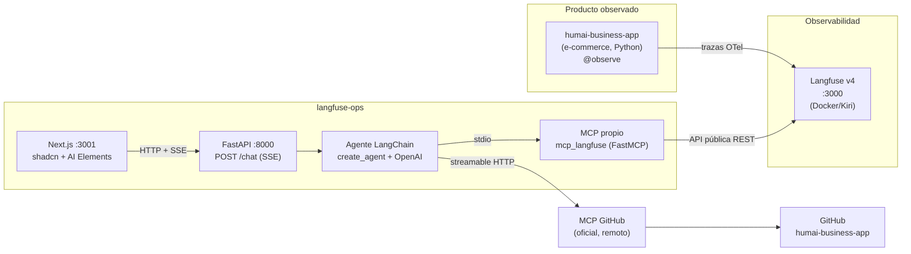
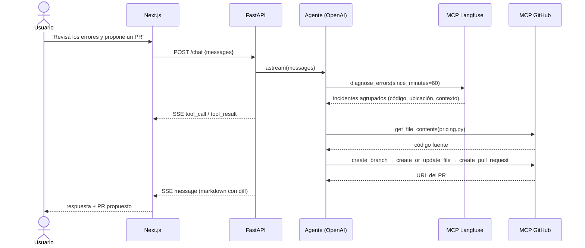

# Arquitectura

## Objetivo

Que un agente de IA pueda **observar** una aplicación real (salud, logs, métricas), **diagnosticar** fallos y **actuar** (proponer un PR), usando **MCP** como contrato estándar entre el agente y cada sistema externo.

## Vista general

## Capas

| # | Capa | Carpeta / repo | Responsabilidad |
|---|---|---|---|
| 1 | Producto observado | `humai-business-app` | Genera trazas, spans y errores reales con el SDK de Langfuse |
| 2 | Observabilidad | `infra/` | Langfuse v4 autoalojado: recibe, almacena y expone las trazas |
| 3 | **MCP propio** | `mcp_langfuse/` | Traduce la API de Langfuse a *tools* que un agente entiende |
| 4 | **MCP externo** | GitHub (remoto) | Acciones sobre el repo: leer código, ramas, commits, PRs |
| 5 | Agente | `api/agent.py` | Razona, decide qué tools llamar, redacta el diagnóstico |
| 6 | API | `api/main.py` | Expone el agente por HTTP con streaming de eventos |
| 7 | Frontend | `web/` | Chat agéntico que muestra respuestas y llamadas a tools |

## Flujo de una consulta

## Del error al PR (end to end)

1. `traffic.py` simula compras. `checkout()` falla con `InvalidCoupon` si el cupón viene en minúscula.
2. `report_error()` marca el span con `level=ERROR` y metadata: `error.code`, `error.type`, `error.location`, `error.stacktrace`, `error.context`.
3. Langfuse guarda la observación.
4. `diagnose_errors` (MCP propio) lee los errores, **colapsa** los spans anidados de un mismo trace y **agrupa** por operación + código. Devuelve conteo, ubicación `pricing.py:14 en apply_discount`, contexto y trace ids de ejemplo.
5. El agente lee `pricing.py` con el MCP de GitHub, propone el fix y abre un PR citando la evidencia.
6. Una persona revisa y hace el merge.

## Decisiones de diseño

- **MCP como frontera.** El agente no conoce la API de Langfuse ni la de GitHub: solo ve tools con schema. Cambiar de backend de observabilidad implica reescribir solo `mcp_langfuse`.
- **Propio + externo.** Lo propio donde no existe un MCP (Langfuse v4); lo externo donde ya hay uno oficial (GitHub).
- **Solo lectura en el MCP propio.** El agente observa; las escrituras pasan por GitHub y bajo guardrails.
- **Capas limpias en el MCP:** `config` → `client` → `diagnostics` → `server`. La lógica de negocio (`diagnostics.py`) es pura y testeable sin red.
- **Inyección de dependencias.** `build_server(client)` acepta un cliente falso, así los tests corren en memoria.
- **Human in the loop.** El agente propone, la persona aprueba el merge.
- **Streaming por SSE.** El front muestra cada tool call en vivo.

## Puertos

| Servicio | Puerto |
|---|---|
| Langfuse | 3000 |
| Frontend Next.js | 3001 |
| API FastAPI | 8000 |
| MCP propio por HTTP (opcional) | 8765 |

## Límites conocidos

- Langfuse v4 corre en modo *events_only*: no existen `/traces`, `/observations` ni `/metrics/daily` v1. Se usan `v2/observations` y `v2/metrics`.
- Los `tool_call` del stream no llevan id; el front empareja resultados por nombre de tool (puede cruzarse con llamadas paralelas a la misma tool).
- El agente no tiene memoria entre sesiones; el historial lo mantiene el front.
